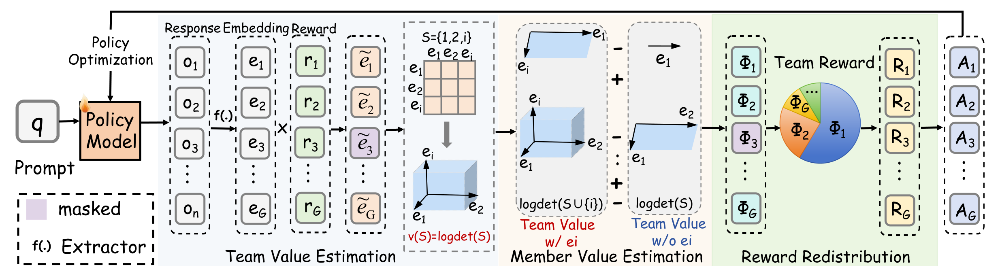

<h1 align="center">Breaking <i>Winner-Takes-All</i>: Cooperative Policy Optimization Improves Diverse LLM Reasoning</h1>

<p align="center">
  Haoxuan Chen &nbsp;&middot;&nbsp; Tianming Liang &nbsp;&middot;&nbsp; Wei-Shi Zheng &nbsp;&middot;&nbsp; Jian-Fang Hu<sup>*</sup><br>
  ISEE Lab, Sun Yat-sen University<br>
</p>

<p align="center">
  <a href="LICENSE"></a>
  <a href="https://github.com/volcengine/verl"></a>
  
</p>

This repository provides the official training implementation of **Group
Cooperative Policy Optimization (GCPO)**. 

## Overview

Group-based RLVR methods usually optimize sampled responses as individual
competitors. This can concentrate learning on a small number of successful
reasoning patterns. GCPO instead treats the responses sampled for one prompt as
a team and assigns credit according to each response's contribution to the
team's valid solution coverage.

<p align="center">
  
</p>

<p align="center"><i>
GCPO estimates team-level solution coverage, assigns each rollout a Shapley
credit, and redistributes the group reward before policy optimization.
</i></p>

GCPO has three stages:

1. **Team value estimation.** Correctness-gated response embeddings define the
   semantic volume covered by a rollout group.
2. **Member credit assignment.** Shapley values measure each rollout's average
   marginal contribution to the team value.
3. **Reward redistribution.** The original group reward is redistributed by
   cooperative credit, preserving the reward budget while favoring correct and
   non-redundant reasoning paths.

For binary verifier rewards $r_i$ and normalized semantic embeddings
$\hat{z}_i$, GCPO builds the reward-gated kernel

$$
L_{ij} = r_i r_j \langle \hat{z}_i, \hat{z}_j \rangle,
\qquad
v(S) = \log \det(I + \eta L_S).
$$

The recipe uses binary Math-Verify rewards, frozen
`sentence-transformers/all-MiniLM-L6-v2` embeddings, and exact Shapley credit
assignment for the default group size of eight. Larger groups use the
permutation-sampled estimator.

## Installation

GCPO was tested with Python 3.10, PyTorch 2.6.0, Transformers 4.51.1,
vLLM 0.8.5.post1, and eight NVIDIA GPUs. Start from an environment that can run
VERL v0.4.1 with FSDP and vLLM.

```bash
git clone https://github.com/bradybuddiemarch/gcpo.git
cd gcpo

pip install -r requirements.txt
bash scripts/setup_verl.sh
```

`setup_verl.sh` checks out VERL v0.4.1 at commit
`8d9e350ea58c7ad4b50dd14d9dcb50577242c55f`, applies the GCPO patch, and
installs this repository in editable mode. Install the remaining VERL runtime
dependencies when they are not already available in your environment:

```bash
pip install -e 'third_party/verl[vllm]'
```

## Model Preparation

Download the base policy and semantic encoder to `model/`:

```bash
huggingface-cli download Qwen/Qwen3-4B \
  --local-dir model/qwen3_4B

huggingface-cli download Qwen/Qwen3-1.7B \
  --local-dir model/qwen3_1.7B

huggingface-cli download sentence-transformers/all-MiniLM-L6-v2 \
  --local-dir model/all-MiniLM-L6-v2
```

The training launcher reads both models locally and enables Hugging Face
offline mode. The expected layout is:

```text
model/
|-- qwen3_4B/
`-- all-MiniLM-L6-v2/
```

See [`model/README.md`](model/README.md) for the required files and path
overrides.

## Data Preparation

We train on
[`open-r1/DAPO-Math-17k-Processed`](https://huggingface.co/datasets/open-r1/DAPO-Math-17k-Processed)
and use
[`BytedTsinghua-SIA/AIME-2024`](https://huggingface.co/datasets/BytedTsinghua-SIA/AIME-2024)
for validation.

```bash
python3 scripts/data/prepare_dapo_math_17k.py
```

This creates:

```text
data/dapo_math_17k/train.parquet    # 17,398 training prompts
data/dapo_math_17k/test.parquet     # 30 AIME 2024 problems
```

Local Parquet snapshots can be used on machines without dataset access:

```bash
python3 scripts/data/prepare_dapo_math_17k.py \
  --train-local /path/to/dapo_snapshot \
  --validation-local /path/to/aime24.parquet
```

## Training

Launch the Qwen3-4B experiment on eight GPUs:

```bash
bash scripts/train/run_qwen3_4b_gcpo.sh
```

The default recipe follows the paper configuration:

| Configuration | Value |
|:--|:--|
| Base model | Qwen3-4B / 1.7B |
| Training data | DAPO-Math-17K-Processed |
| Semantic encoder | all-MiniLM-L6-v2 |
| GPUs | 8 |
| Rollouts per prompt | 8 |
| Train batch size | 256 |
| Prompt / response length | 1024 / 8192 |
| vLLM max model length | 9216 |
| Learning rate | `1e-6` |
| PPO mini-batch size | 16 |
| Clip range | `[0.2, 0.28]` |
| GCPO $\eta$ | 1.0 |
| Reward | binary Math-Verify |
| Loss aggregation | `token-mean` |

Model, data, and encoder paths can be overridden without editing the launcher:

```bash
MODEL_PATH=/path/to/Qwen3-4B-Base \
SENTENCE_TRANSFORMER_MODEL=/path/to/all-MiniLM-L6-v2 \
TRAIN_FILE=/path/to/train.parquet \
VAL_FILE=/path/to/aime24.parquet \
bash scripts/train/run_qwen3_4b_gcpo.sh
```

Additional arguments are forwarded to Hydra. For example, the following runs
one short step to check the training pipeline:

```bash
bash scripts/train/run_qwen3_4b_gcpo.sh \
  trainer.total_training_steps=1 \
  trainer.val_before_train=False \
  trainer.save_freq=-1 \
  trainer.test_freq=-1 \
  data.max_response_length=512 \
  actor_rollout_ref.rollout.max_model_len=1536 \
  actor_rollout_ref.rollout.max_num_batched_tokens=1536
```

## Code Structure

```text
src/gcpo/estimator.py              GCPO credit assignment and advantages
src/gcpo/encoder.py                frozen sentence encoder
src/gcpo/reward.py                 binary Math-Verify reward
patches/verl-v0.4.1-gcpo.patch     VERL integration
scripts/data/                      dataset preparation
scripts/train/                     training launchers
```

## Tests

```bash
PYTHONPATH=src:third_party/verl pytest -q
```

## Acknowledgements

GCPO is built on [VERL](https://github.com/volcengine/verl),
[vLLM](https://github.com/vllm-project/vllm),
[Math-Verify](https://github.com/huggingface/Math-Verify), and
[Sentence Transformers](https://github.com/UKPLab/sentence-transformers).
We thank the authors of these projects and the maintainers of the
DAPO-Math-17K-Processed dataset.

## Citation

If you find this work useful, please cite:

```bibtex
@article{chen2026breaking,
  title={Breaking $$\backslash$textit $\{$Winner-Takes-All$\}$ $: Cooperative Policy Optimization Improves Diverse LLM Reasoning},
  author={Chen, Haoxuan and Liang, Tianming and Zheng, Wei-Shi and Hu, Jian-Fang},
  journal={arXiv preprint arXiv:2605.11461},
  year={2026}
}
```

## License

This project is released under the [Apache License 2.0](LICENSE).
